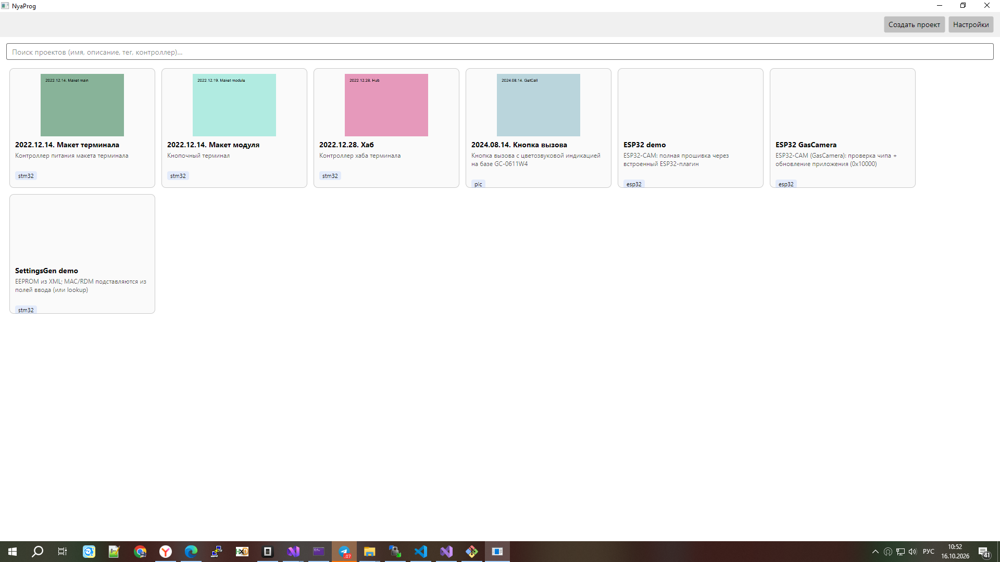

# NyaProg.Plugins.SettingsGen

Плагин генерации **блока настроек (EEPROM)** из XML-описания — развитие утилиты
`hexnyan` (источник: `G:\Projects\ADL\hexnyan`). Собирает бинарный блок по полям
и сохраняет его как **bin** или **Intel HEX** по заданному смещению.

Расширения относительно `hexnyan`: **контрольные суммы** (sum/CRC с настраиваемыми
параметрами), **хэши** (MD5/SHA-1/SHA-256), источник данных (внешний файл),
подстановки из аргументов и приоритет расчёта.

Инструмент: **Settings** (`settingsgen.tool`), команда **`settings`**.



## Формат описания (`<eeprom>`)

Поля идут последовательно; имя элемента — тип поля. Значение поля может быть
литералом или плейсхолдером `{имя}` (значение аргумента/опции/выхода `lookup`).

```xml
<eeprom>
  <u32 name="Magic" default="0x61" />
  <u8  name="Type" default="4" />
  <mac name="MAC" default="{mac}" />     <!-- MAC из поля ввода / поиска -->
  <u32 name="RDM" default="{rdm}" />     <!-- RDM оттуда же -->
  <s16 name="Name" default="Dim4" />
  <p2  name="Reserved" default="0xFF" />
  <crc16 name="CRC" />                    <!-- CRC-16/CCITT-FALSE поверх данных -->
</eeprom>
```

### Числовые значения (основания)

| Запись | Основание | Пример |
|--------|-----------|--------|
| `234` | десятичное | 234 |
| `0x1abc` | шестнадцатеричное | 0x1ABC |
| `0123` / `0o123` | восьмеричное | 83 |
| `0b10010110` | двоичное | 150 |

### Типы полей (значения)

| Тип | Описание |
|-----|----------|
| `u8`,`u16`,`u32`,`u48`,`u64` | целое, little-endian |
| `U8`,`U16`,`U32`,`U48`,`U64` | целое, big-endian |
| `mac` / `MAC` | MAC-адрес (6 байт) |
| `ip` / `IP4` | IPv4-адрес (4 байта) |
| `sN` | строка фиксированной длины `N` (ASCII, добор нулями) |
| `xN` | hex-данные на `N` байт |
| `pN` | паддинг `N` байт (`default` или массив `<V>…</V>`) |

### Вычисляемые поля (суммы, CRC, хэши)

Считаются **после подстановки всех значений** и записываются в своё место в блоке.
Общие атрибуты: `order`, `source`, `offset`, `size`.

| Тип | Что пишет |
|-----|-----------|
| `sum8`, `sum16`, `sum32` | сумма байт (LE) |
| `crc8`, `crc16`, `crc32` | CRC с настраиваемыми параметрами (LE) |
| `md5`, `sha1`, `sha256` | хэш (байты как есть) |
| `lenN` | длина обработанных данных (N байт, LE) |

**Параметры CRC** (атрибуты): `poly` (обычный полином, MSB), `init`, `xorout`,
`refin`, `refout`.

Значения по умолчанию:

| Тип | poly | init | refin/refout | xorout |
|-----|------|------|--------------|--------|
| `crc8` | `0x07` | `0x00` | нет | `0` |
| `crc16` | `0x1021` (CCITT-FALSE) | `0xFFFF` | нет | `0` |
| `crc32` | `0x04C11DB7` (стандарт) | `0xFFFFFFFF` | да | `0xFFFFFFFF` |

**Источник данных** (`source`): по умолчанию — сам блок настроек; можно указать
внешний файл (относительно каталога проекта). `offset` — начало, `size` — сколько
байт (0 — до конца файла или до позиции поля).

**Порядок** (`order`): меньше — раньше. Поля с одинаковым `order` считаются в
порядке расположения в файле. По умолчанию `0`.

Примеры:

```xml
<!-- CRC-32 по данным настроек (до этого поля) -->
<crc32 name="CRC" />

<!-- CRC-16 с настраиваемыми параметрами -->
<crc16 name="CRC" poly="0x8005" init="0x0000" xorout="0x0000" refin="1" refout="1" />

<!-- SHA-256 от внешнего файла, байты [0x100 .. 0x100+0x1000) -->
<sha256 name="FwHash" source="firmware.bin" offset="0x100" size="0x1000" />

<!-- сначала считается CRC, затем хэш (включая CRC) -->
<crc16 name="CRC" order="0" />
<sha256 name="SHA" order="1" />
```

## Команда `settings`

| Параметр | Обязателен | По умолчанию | Описание |
|----------|:----------:|--------------|----------|
| `file` | да | — | XML-описание (относительно каталога проекта) |
| `out` | да | — | файл результата |
| `format` | нет | `hex` | `hex` \| `bin` |
| `offset` | нет | `0` | смещение (`0x...` или dec) |
| `set` | нет | — | переопределения полей: `name=value;name2=value2` |

Выходы: `file`, `size`, `offset`. Плейсхолдеры `{...}` в аргументах раскрываются
движком (для нативных команд).

## Пример проекта (как в реальных проектах)

```xml
<project>
  <name value="NewPolka" />
  <type value="stm32" />
  <target>
    <name value="Прошивка 4к дим" />
    <device value="STM32F405VGT6" />
    <input name="mac" value="MAC" default="00:11:22:33:44:55" id="polka.mac" />
    <input name="rdm" value="hex32" default="0x00000001" id="polka.rdm" />
    <options>
      <list label="Rack type">
        <option label="Диммер 4к" default=""><value name="ee" val="dim4ch.xml" /></option>
        <option label="Диммер 2к"><value name="ee" val="dim2ch.xml" /></option>
      </list>
    </options>
    <steps>
      <settings file="{ee}" out="lirdm.hex" format="hex" offset="0x08010000" comment="Генерация EEPROM" />
      <wflash value="lirdm.hex" comment="Прошивка настроек" />
      <wflash value="polka_relay.hex" comment="Прошивка ПО" />
    </steps>
  </target>
</project>
```

MAC/RDM берутся из полей ввода (или из `lookup` по серийнику) и подставляются в
EEPROM вместо значений по умолчанию.

## MAC/RDM из REST (lookup) → EEPROM

Типовой сценарий: **серийный номер → REST API → MAC/RDM → EEPROM**.

1. Поле ввода серийника: `<input name="serial" value="str" default="SN12345" />`.
2. Команда **`lookup`** (плагин Net) запрашивает REST и кладёт значения в переменные
   (`mac`, `rdm`) — они попадают в **окружение запуска**.
3. Команда **`settings`** подставляет их в описание настроек (`default="{mac}"`,
   `default="{rdm}"`) и формирует EEPROM.

Проект:

```xml
<project>
  <name value="EEPROM by REST" />
  <type value="stm32" />
  <target>
    <name value="Настройки" />
    <input name="serial" value="str" default="SN12345" />
    <steps>
      <lookup url="http://127.0.0.1:8099/device/{serial}"
              extract="mac=json:$.network.mac; rdm=json:$.rdm"
              comment="MAC/RDM по серийнику" />
      <settings file="settings.xml" out="eeprom.hex" format="hex" offset="0x08010000"
                comment="EEPROM (MAC/RDM из lookup)" />
    </steps>
  </target>
</project>
```

`settings.xml`:

```xml
<eeprom>
  <u32 name="Magic" default="0x61" />
  <u8  name="Type" default="4" />
  <mac name="MAC" default="{mac}" />
  <u32 name="RDM" default="{rdm}" />
  <crc16 name="CRC" />
</eeprom>
```

Сервер (пример): `NyaProg.Modules.Net/examples/fastapi_lookup.py` —
`GET /device/{serial}` возвращает JSON с `network.mac` и `rdm`.

Проверка (CLI, без UI):

```
NyaProg.Cli config.xml --run "EEPROM by REST" 0
  lookup:   Ok
  settings: Ok
  mac = AA:BB:CC:DD:EE:FF   rdm = 0x00000001
```

Результат (`eeprom.hex`, offset `0x08010000`): `Magic` `Type` `MAC=AA BB CC DD EE FF`
`RDM=01 00 00 00` `CRC16`. То есть выходы `lookup` вливаются в окружение запуска и
используются следующим шагом `settings`.

## Размер файла в переменную

Отдельный плагин **`NyaProg.Plugins.FileInfo`** — команда `filesize`:

```xml
<!-- один файл -->
<filesize file="polka_relay.hex" var="fwsize" comment="Размер ПО" />
<!-- несколько -->
<filesize set="fw=polka_relay.hex;ee=lirdm.hex" comment="Размеры" />
```

Далее `{fwsize}` / `{fw}` доступны в других шагах и в описании настроек.

## Совместимость с hexnyan

Имена полей и раскладка совместимы (`u8..u64`, `U*`, `MAC`, `IP4`, `sN`, `xN`,
`pN`). Добавлены вычисляемые поля, источник данных и подстановки. Вывод — Intel
HEX или bin с паддингом `0xFF` до offset.
